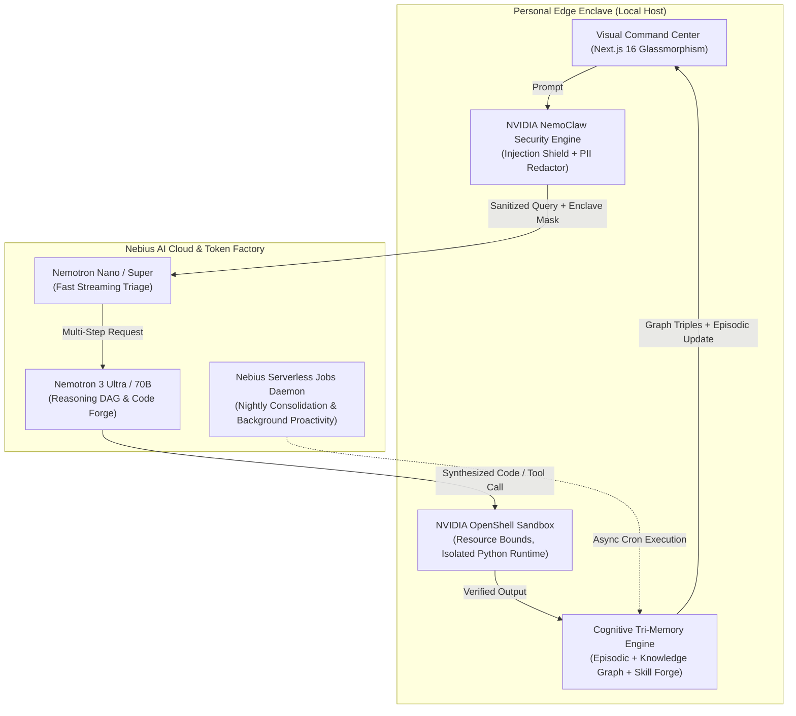

# 🛡️ SovereignClaw OS
### *The Zero-Trust, Self-Evolving Autonomous Personal AI Operating System*
**Built for the NVIDIA x Nebius Global AI Hackathon — Personal AI Track**

[](https://build.nvidia.com)
[](https://tokenfactory.nebius.ai)
[](https://github.com/NVIDIA)
[](https://github.com/NVIDIA)

---

## 🌟 Executive Summary & Hackathon Pitch

Most personal AI projects are passive web chat interfaces connected to basic RAG vector stores. **SovereignClaw** redefines the category by providing a **true personal operating system** built on open, sovereign infrastructure:

1. **Zero-Trust Edge Enclave with NVIDIA NemoClaw**: Incoming instructions are scanned for adversarial prompt injections and evasion payloads. Private credentials (API tokens, emails, keys) are stripped into a local cryptographic enclave before sending sanitized prompts to cloud inference.
2. **Tiered Nemotron Orchestration on Nebius Token Factory**:
   - **Nemotron Nano / Super**: Sub-50ms streaming triage, real-time intent classification, and streaming dialogue.
   - **Nemotron 3 Ultra**: Deep reasoning, structured DAG execution plans, and autonomous Python code synthesis.
3. **NVIDIA OpenShell Hardware-Isolated Sandbox**: When the agent synthesizes or executes code, it runs in a kernel-sandboxed environment with seccomp-filtered system calls, strict memory ceilings, and sub-second timeouts.
4. **Cognitive Tri-Memory Engine**:
   - **Episodic Stream**: Chronological interaction logs with affective sentiment tracking.
   - **Associative Knowledge Graph**: Subject-Predicate-Object semantic triples automatically updated through daily usage.
   - **Procedural Skill Forge**: The agent autonomously codes, verifies in OpenShell, and compiles new reusable tools.
5. **Always-On Proactivity with Nebius Serverless Jobs**: Asynchronous background workers that perform overnight cognitive consolidation, proactive calendar briefing, and automated skill simulations.

---

## 🏗️ Architecture Overview



---

## 🚀 Quickstart & Setup

### 1. Prerequisites
- **Node.js** v20+ or v24+
- **Python** 3.10+ (for OpenShell local execution)
- *(Optional)* **Nebius Token Factory API Key** (A realistic, high-fidelity fallback is pre-configured so the entire app works out-of-the-box even without active credentials!)

### 2. Clone & Install
```bash
git clone https://github.com/your-username/sovereign-claw.git
cd sovereign-claw
npm install
```

### 3. Configure Environment Variables
Copy `.env.example` to `.env.local`:
```bash
cp .env.example .env.local
```
Add your Nebius Token Factory credentials:
```env
NEBIUS_API_KEY=your_nebius_api_key_here
NEBIUS_BASE_URL=https://api.tokenfactory.nebius.ai/v1
DEFAULT_MODEL_TIER=nemotron-3-ultra
```

### 4. Run Development Server
```bash
npm run dev
```
Open [http://localhost:3000](http://localhost:3000) in your browser.

---

## 🏆 Key Features Demonstrated in the App

### 1. Command Cockpit & Live DAG Telemetry
- Inspect real-time execution DAGs:
  - `Phase 1: NemoClaw Threat & Privacy Scan`
  - `Phase 2: Tri-Memory Graph Traversal`
  - `Phase 3: Nemotron Multi-Step Reasoning DAG`
  - `Phase 4: OpenShell Isolated Kernel Execution`
  - `Phase 5: Memory Update & Final Response`

### 2. Tri-Memory Brain
- **Knowledge Graph Explorer**: View semantic triples with confidence scores, relationship predicates, and timestamps.
- **Episodic Interaction Log**: Track conversational context and outcome sentiments.

### 3. Procedural Skill Forge (Powered by OpenShell)
- **Pre-installed tools**:
  - `portfolio_risk_analyzer`: Computes Sharpe ratio, volatility, and asset weights in Python.
  - `python_ast_security_scanner`: Scans code for AST vulnerabilities.
- **Autonomous Tool Creation**: Author or ask Nemotron to write a new Python script; SovereignClaw verifies the code in an OpenShell sandbox before permanently registering it into your procedural toolbox.

### 4. NemoClaw Security Enclave
- Test prompt injections live with the interactive threat detector.
- Verify zero-egress PII redactor: API tokens and private keys are replaced with cryptographic enclave placeholders `[ENCLAVE_API_KEY_XXXX]` before cloud requests.

### 5. Nebius Serverless Asynchronous Jobs
- Trigger background serverless jobs with one click:
  - **Nightly Consolidation**: Merges conversation fragments into the Knowledge Graph.
  - **Batch OpenShell Simulations**: Runs regression audits across all procedural skills.
  - **Proactive Morning Briefing**: Synthesizes tasks and alerts without user prompting.

---

## 📹 Hackathon Submission Metadata

- **Track**: Personal AI Track
- **Models Used**:
  - `nvidia/nemotron-4-340b-instruct` (Nemotron 3 Ultra tier)
  - `nvidia/llama-3.1-nemotron-70b-instruct` (Nemotron Super tier)
  - `nvidia/nemotron-mini-4b-instruct` (Nemotron Nano tier)
- **Infrastructure**: Nebius Token Factory, Nebius AI Cloud, Nebius Serverless Endpoints.
- **Security & Sandboxing**: NVIDIA NemoClaw Policy Guardrails, NVIDIA OpenShell Isolated Runtime.

---

*Built with passion for the open AI ecosystem.*
